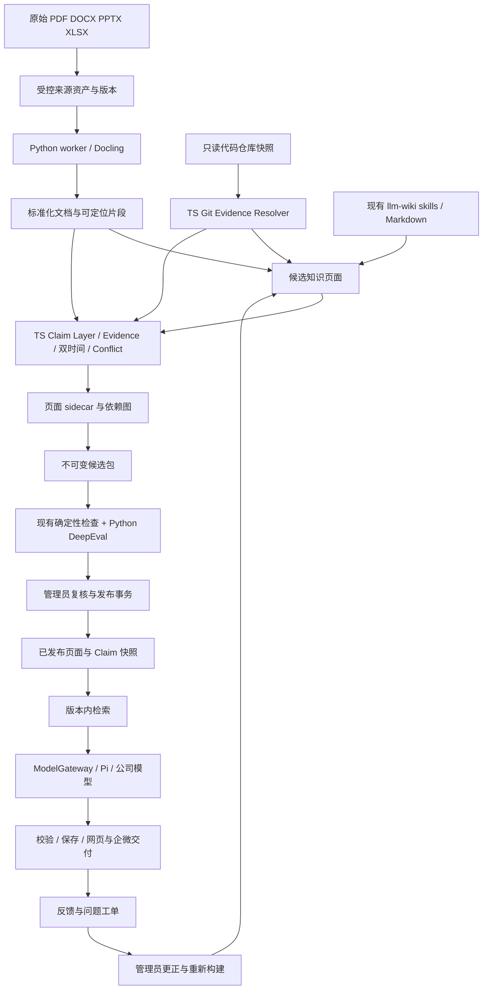

# wikiBot 实施设计 v0.5：文档标准化、Claim 与增量知识维护

日期：2026-10-07\
代码基线：`cbc47424012f6841e07ca26131e70092b230c783`（main 与原设计分支在同步时一致）。\
状态：基于现有实现重新设计；本文新增能力尚未实现。本轮进行了源码核对，未重新运行应用测试或真实模型/企微验收。

## 1. 目标、已确认选择与边界

继续服务不同业务人群：普通成员可以自由提问、选择表达风格、反馈及登记问题；领域管理员可以处理工单、维护知识、解决知识冲突并复核发布。业务/技术视角与入门/熟练深度控制表达，成员/管理员角色控制操作权限。

保留已经运行的检索优先路线：发布页面检索 → 单次公司模型生成 → 协议/引用校验 → 网页/企微交付。ADR-0004 已取消人工 ProcedureSpec 和互斥路径引擎，本版不恢复这些接入成本。Claim 是可追溯的原子事实及其版本，不是要求专家重新编制全部业务流程的执行 DSL。

用户确定的四项选择：

| 项目 | 采用方式 | 放置位置 |
|---|---|---|
| Docling | 直接引入 Python library | 后台文件标准化，处理 PDF/DOCX/PPTX/XLSX |
| HL-Mem | 吸收 Claim、Evidence、双时间、Conflict 模型，轻量自研 | TypeScript 领域层与当前 SQLite |
| OpenWiki | 吸收证据 sidecar、Code Wiki、失效检测和增量处理方法 | 来源 resolver、页面 sidecar、影响分析和候选构建 |
| DeepEval | 直接引入 Python dev/test 依赖 | 本地/CI 和隔离评测作业，结果供发布门禁消费 |

HL-Mem 与 OpenWiki 的借鉴对象分别是 [lohr13/hl_mem](https://github.com/lohr13/hl_mem/blob/main/docs/architecture.md) 与 [langchain-ai/openwiki](https://github.com/langchain-ai/openwiki/blob/main/openwiki/concepts/grounded-claims.md)。前者的现有 namespace 不构成授权边界；后者当前 Claims 主要针对版本化代码仓库。以下跨办公文档、领域权限和业务事实治理是 wikiBot 自己的设计。

本版交付范围以一个公司部署、多个领域为基础。来源是用户现有 llm-wiki skills 管理的 Markdown 工作区，以及显式配置的原始文档/代码仓库；不把早期研究的桌面 llm_wiki 应用当作必需服务。原始档案只读，专家更正独立留痕。私人历史、工单证据和发布知识仍分别授权。

## 2. 代码现状：可以复用什么，需要改变什么

| 能力 | 基线实现事实 | 本版处理 |
|---|---|---|
| 应用 | Fastify、TypeScript、Node >=24.13.0；网页为 Preact SPA | 保留，增补知识管理视图 |
| 模型 | `ModelGateway/PiGateway`；固定 pi-ai 0.87.1，单次调用为主 | 保留适配与取消；抽取/评测使用独立后台预算 |
| 数据库 | `node:sqlite`、WAL、BEGIN IMMEDIATE；objects JSON 表、commands/audit 等 | 单机阶段保留；Claim 等新增专用表与显式迁移 |
| 发布包 | 严格 Zod schema：pages + cases + config，可带 sourceArtifacts；无 bundle schemaVersion | 增加 V1/V2 明确解析与历史兼容 |
| 检索 | 中文二元组/拉丁词、标题加权、默认 topK=6、上下文 60000 字节 | 保留词法基线，加发布版本内 Claim/证据投影 |
| 回答 | 单个 JSON text/citations/outcome，支持解析修复、预览和正文降级 | 新协议区分生成、证据完整性和交付；停止伪造引用 |
| 发布治理 | Domain.active/epoch、baseActive/baseEpoch、modelEpoch、评测后人工复核 | 复用事务，再绑定来源、Claim、sidecar 和新评测报告 |
| 来源维护 | 快照两次读取及目录校验；更正日志、租约、manual/isolated-markdown adapter | Docling 与 sidecar 接入该受控链路；真实 skill adapter 仍需验证 |
| 附件 | 已发布来源只支持文本摘录与 PNG/JPEG，附件总量限制 2 MiB | 新建原始文件资产通道，不能把 PDF 直接塞进现有附件字段 |
| Code Wiki | 只有 wikiRepository/codeRepository 配置字段，尚无版本化代码取证链路 | 新增只读 Git resolver 与派生页面构建 |
| 评测 | 核对 outcome、expectedCitations，记录 complete/pass、lease、modelEpoch | 保留确定性检查；增加内容期望、DeepEval 与可信报告导入 |
| 权限与渠道 | 成员/管理员、表达标签、SSO/密码入口、多 bot、回执/恢复与工单 | 原接口复用；新资产/Claim/作业同样检查领域和对象权限 |

源码入口：[core](../../src/core.ts)、[包结构](../../src/procedures.ts)、[模型](../../src/adapters/model.ts)、[检索](../../src/retrieval.ts)、[生成](../../src/explanation.ts)、[发布](../../src/publication.ts)、[评测](../../src/evaluations.ts)、[来源维护](../../src/source-maintenance.ts)、[受控写回](../../src/controlled-source.ts)、[附件](../../src/source-artifacts.ts)。

现有能力不能被文档扩大解释：

- SQLite 是实际存储，并非早期文档建议的 PostgreSQL；当前不存在独立通用 Python 文档处理服务。
- 当前评测通过不证明回答的所有要点正确或完整；合法引用也不证明语义蕴含。
- `JsonTextExtractor` 的预览并不等同于最终协议/证据校验；当前降级路径可能自动补第一检索页引用，本版将调整。
- 真实来源适配默认需要人工交接，隔离副本 adapter 不能当作真实 skills 写回已验证。
- 历史仓库有测试与联调证据，其适用提交、环境和局限继续保留；本稿不把历史结果当成本次新能力的通过证明。

## 3. 总体架构与责任划分

TS 应用继续拥有身份、权限、业务事务、队列状态、知识发布、工单、Claim 裁决及渠道交付。Python 分两种运行环境：Docling 是标准化 worker 的运行依赖；DeepEval 是评测环境的 dev/test 依赖。在线问答进程不等待 Python 解析文件或运行 judge。

首版后台任务由 TS 调度受控 Python CLI 子进程：固定入口、argv 数组、任务工作目录、资源/超时上限，交换版本化 JSON 与内容寻址文件。Python 不直接写主 SQLite，不接受模型生成的命令或任意本机路径。后续需要多机扩容时替换任务传输层即可，暂不引入 HTTP 微服务群。

权威边界：

| 数据 | 权威所在 |
|---|---|
| 原始文档/代码 | 不可变来源文件版本 / 已解析的 Git commit 与 blob |
| 业务 Wiki 正文 | 现有受控工作区，按已批准来源和更正维护 |
| Code Wiki 派生正文 | 独立派生工作区，引用原仓库但不写源代码 |
| Claim、Conflict、审批和任务 | TS 业务层写入 SQLite，按修订与发布记录追溯 |
| sidecar | 上述候选/已发布 Claim 的校验与交换投影，不是第二个随意可写的数据库 |
| 线上问答依据 | 一次发布中的不可变页面、Claim 与证据快照 |

## 4. Docling：原始文档到可追溯标准化结果

### 4.1 接入契约

[Docling 官方格式表](https://docling-project.github.io/docling/usage/supported_formats/)列出 PDF、DOCX、PPTX、XLSX 支持。采用其 Python DocumentConverter；保留结构化文档和 Markdown 导出，wikiBot 在外层定义自己的 NormalizedDocument 契约。库支持某格式不等于全部页码、单元格、图表、脚注或隐藏内容都能无损映射，定位能力必须按样本验证。

`SourceAsset` 保存 domain、sourceId、sourceVersionId、媒体类型、原始字节 SHA-256、存储 key、提交人、保密/公开引用范围及创建时间。原文件不改写，不将其 base64 嵌入 Bundle；已有静态附件规则继续适用于已有类型。

`NormalizationJob` 输入绑定 sourceVersionId、normalizerProfileHash、schemaVersion、输入字节摘要。输出至少包含：

- Docling 版本、解析配置/OCR/模型工件标识、开始/结束时间及结果摘要。
- 标准化 JSON、Markdown、块索引及各产物 SHA-256。
- 有序 NormalizedBlock：blockId、kind、text/table、来源定位、内容摘要。
- parseStatus=complete/partial/failed、warnings、不可支持或无法定位的部分。
- jobId、attempt、fencingToken；相同输入及配置命中缓存可复用工件，不直接复用旧审批。

PDF 优先保存页码与区域；DOCX 保存实际可取得的结构节点/标题定位；PPTX 保存能解析的幻灯片及元素位置；XLSX 保存工作表及可证明的单元格范围。适配器拿不到精确坐标时明确标成 document/block 级，不能编造页码、幻灯片编号或单元格引用。blockId 的稳定范围是特定来源版本和标准化配置，不能用正文相似度跨版本冒充同一块。

解析出的电子表格值注明 cached/formula/text 属性；首版不执行公式、宏或外链，也不把解析当成计算引擎。表格列头、单位、合并单元格与脚注尽量保留；无法保持语义的表格阻断其自动事实提取，交管理员复核。

转换生成的图片走已批准静态附件或新资产引用，不能绕过原有文件类型/大小检查。外部超链接作为来源信息或受控 Evidence 处理，不通过全面放开 validateSourceLinks 来导入。缓存键至少包含 domain、来源字节摘要和配置摘要，工件复用不授予跨域访问权。

### 4.2 运行、失败与权限

作业依次为 queued → running → succeeded/partial/failed/cancelled；工件先写临时目录，全部摘要核验后写完成清单。父进程只导入完整且租约匹配的结果。partial 保留可诊断产物，默认不能作为完整文档直接发布；管理员可选择有明确边界的片段另行审核。

文件类型/实际 MIME、展开大小、页数、CPU/内存、超时和并发均有配置上限；初期串行重型解析，按真实样本调优。原文件范围与后台工件属于领域管理员/处理服务权限，普通用户仅能读取发布时允许的摘录或原件。上传成功、解析成功和批准发布分别显示状态。

按[官方离线配置](https://docling-project.github.io/docling/usage/advanced_options/)预取模型并记录工件；生产关闭未批准的远程解析调用，依赖和模型下载在构建/配置阶段完成。docling、OCR 后端和 Python 版本在接入试验后精确锁定，不能依赖浮动 latest。

已有 Markdown 工作区可继续直接快照；Docling 只承担需要转换的来源。首次引入它不要求重做现有 161 页历史 Wiki，也不能将解析器输出未经审核直接替换在线页面。

## 5. 轻量 Claim Layer：事实、证据、双时间与冲突

### 5.1 最小数据模型

Claim 只用于受控知识事实。用户风格偏好仍是结构化偏好，私人聊天仍是会话，工单仍是工单；这些内容不能自动升级为全域共享事实。

| 对象 | 最小字段 |
|---|---|
| Claim | domain、claimId、subjectId、predicate、qualifiers、owner；标识同一事实主题的演变线 |
| ClaimVersion | versionId、claimId、statement、typedValue、validityKind、validFrom/validTo、recordedFrom/recordedTo、status、supersedesVersionId、extractionProfileHash |
| Evidence | evidenceId、domain、sourceVersionId、resolverKind、locator、raw/normalized 内容摘要、允许引用范围 |
| ClaimEvidence | claimVersionId、evidenceId、relation=supports/contradicts/context、审核标记 |
| Conflict | conflictId、domain、conflictKey、成员版本、reason、status、version、decision/reviewer |
| PageClaim | pageId、pageVersionHash、claimVersionId、定位到段落的可选映射 |
| ClaimEvent | 操作者、来源任务、前后版本、动作、理由、事务序号和时间 |
| ReleaseClaim | releaseId、claimVersionId、所绑定的 Evidence 与 snapshot hash |

ClaimVersion 采取 proposed/approved/rejected/retracted 等生命周期；证据 fresh/stale/unresolved 与冲突 open/resolved 是独立维度。被发现来源变化不等于已经证实原命题错误；未经重新确认的 stale/unresolved 不能标为当前已核验事实。

管理员按页面或变更批次核对并批准 Claim 与证据，系统记录其中每个版本的复核关联；不要求日常维护逐条重复点击审批。对冲突或高风险事实再展开单独裁决。

ClaimLayer 的事务与授权由 TypeScript 实现。单机阶段在现有 SQLite 增加 claim_versions、evidence、claim_evidence、conflicts、page_claims、release_claims、claim_events 等专用表和必要索引。复用 Store.command 的幂等/权限审计规则，由同一 SQLite 连接执行相关事务；不能在外层 tx 中嵌套 BEGIN IMMEDIATE。声明版本、关联关系和 sidecar 投影任务必须一起提交。

标识变化的规则：相同主题更新值创建新的 ClaimVersion；主题或限定条件改变则创建新 Claim 并显式关联。仅在被证明同义时合并，模型相似度不能自动跨客户、产品、环境或领域合并事实。抽取器不给自己授予 approved；管理员审核的是来源、陈述与适用范围。

### 5.2 双时间的精确定义

- valid time：事实在业务世界中的适用区间，采用 UTC 半开区间 [validFrom, validTo)。
- recorded time：wikiBot 写入/纠正该版本的系统记录区间 [recordedFrom, recordedTo)，由服务端事务时间与单调事件序号确定，模型不能填写。
- 来源没给生效时间时记录 validityKind=unknown；经负责人确认的“当前有效”可标为 reviewer_asserted 并记录依据。不能把上传时间自动当成事实生效时间。
- 更正保留原版本与事件；允许同一事务关闭旧 recorded 区间并新增版本，不原地改写旧事实正文。validTo 与 recordedTo 不是同一个字段。

例如：9 月 1 日已发布“限额 100”；10 月 7 日收到并核准“9 月 20 日起限额 80”。业务时间 9 月 25 日、站在 10 月 7 日的知识看，应采用获准的 80；要重现 9 月 25 日 bot 实际可见的知识，还必须依据当时生效的发布记录，而不能把 10 月新增的追溯更正塞进旧答案。

三个时间分别处理：事实有效时间、系统记录时间、知识发布时间。普通问答只使用当前固定 release 的批准集合；录入数据库但尚未发布的事实永远不可见。历史查询还需明确 validAt、knownAt 及可访问的发布范围；未知有效期不自动满足指定历史日期查询。已撤回知识可供有权审计者查看，不能借历史查询恢复普通问答服务。

每次发布保存冻结的 ClaimVersion/Evidence 集合和知识记录截止点。后续草稿、冲突处理、recorded 区间关闭不会改写旧 release 的字节或哈希；如需阻止已发布错误内容，仍走现有撤回/更正机制。

### 5.3 冲突规则与人工裁决

conflictKey 由 domain + 规范化主体 + 谓词 + 全部限定条件构成。对“同坐标、有效期重叠、值互斥”的情况可确定性产生候选冲突；未知时间、模糊主体或语义冲突进入待核对，不假装检测完整。不是所有不同数值都冲突，币种、单位、环境、渠道和时间均参与限定。

模型只能提出抽取、去重和冲突候选。首版裁决由领域管理员选择：保留并澄清限定范围、采用更正、同时保留不同有效期、或证据不足不发布。记录理由与被检查的精确版本。新版本不因为写入时间较晚就自动胜出；双来源冲突不能以“多数引用”自动解决。

新候选使用的 Claim 必须为 approved、证据可解析、适用范围明确且没有未解决的相关冲突。争议已影响现行答案时可先撤回对应发布版本；仅把后台 Conflict 标为 open 不会神奇地撤销已发送的消息。

管理员确认事实还须回到受控 Wiki 更正流程，重建相应页面和 sidecar，再复核发布；不能出现“数据库 Claim 已改、Markdown 未改、两边都可用于回答”的双重事实源。

## 6. Sidecar、Code Wiki 与增量更新

### 6.1 页面 sidecar 的职责

借鉴 OpenWiki 的页面旁路元数据和完成边界；wikiBot 定义自己的 schema，不依赖 OpenWiki 私有目录/类型或完整运行时。拟议路径为 `metadata/claims/<pageId>.json`，由助手独立收集进 Bundle V2 的 grounding 元数据，不把它塞入 pages[] 或现有静态附件。

每个 sidecar 包含 schemaVersion、domain、pageId、pageHash、generationId、claimVersionIds、evidence 摘要、依赖列表、coverageMode、projectionHash。sidecar 与对应 Markdown 一起绑定候选哈希；approved/verified 标志必须来自服务端记录，文件作者不能自填字段绕过审核。

工作区的 Markdown 修改会使 pageHash 不匹配，sidecar 进入待重新生成状态。手工编辑 sidecar 只能作为待导入提议，必须经 schema、引用解析、权限和内容复核后进入数据库；导入不能覆盖已发布版本。

生成页和 sidecar 存放于同一个 generation 临时目录，二者校验通过才提交完成 manifest。目录完成后保持不可变，数据库事务引用完整 generation。两个独立 rename 不能被宣称为跨文件原子提交；进程崩溃留下的半成品不得成为完成任务或发布候选。

### 6.2 Evidence Resolver

统一接口负责：解析固定版本 → 返回受控文本和可展示定位 → 校验版本/哈希 → 识别 stale/unresolved。预览与解析权限独立核验，不让证据 URI 成为任意文件或网络读取接口。

| Resolver | 版本身份与定位 | 边界 |
|---|---|---|
| wiki | 工作区快照、pageId、page hash、片段 | 现有人工知识；来源等级注明 wiki_only，不能伪称原始文件举证 |
| document | sourceVersionId、normalizer profile、block/item/页/表定位 | 只读取批准工件，保留原始字节摘要与转换链 |
| repository | repoId、commit SHA、blob SHA、path、可选行范围 | 固定提交的只读代码证据；分支名不能充当不可变版本 |

证据定位与 Markdown 超链接分开。现有 source-formats 会拒绝外链/未知语法；新 resolver 元数据不通过放宽所有 Markdown URL 来接入。用户看到的引用由已授权服务生成，必要时显示摘录/行范围，不直接开放后台真实路径或仓库凭据。

跨来源关联必须显式记录。若文档和代码各自描述不同现状，先形成冲突/待核对项，不让代码来源自动覆盖业务制度，反之亦然。

### 6.3 Code Wiki 的首版能力

现有 codeRepository 字符串仅是配置，接入需补齐：批准的 repoId/URL、凭据引用、branch/ref、解析出的 commit、允许路径、文件类型与排除规则。同步时获取只读不可变快照；不运行仓库脚本、构建、测试或模型给出的 shell。

第一版以文件/函数范围的引用和人工可检查的页面为目标，不承诺完整语言级语义理解。生成页含代码概念、接口/配置说明及版本化引用；每条被标为 grounded 的事实映射到可解析的 Evidence。生成输出、.git 元数据、凭据文件与自身 sidecar 不能成为自动循环举证的来源。

Code Wiki 放在单独派生工作区，通过同一候选包和发布台接入领域。Wiki 正文、Claim、代码证据均需审核，不能将代码仓库的新提交直接变成在线业务指导。管理员对代码说明的更正形成有来源的知识修订；此功能不修改仓库业务代码。

### 6.4 增量处理算法

1. 保存每个来源的已处理版本和配置摘要，比较源字节/commit、标准化配置、抽取提示词、resolver 与渲染版本。
2. 复查持久化依赖，而非只看 Git changedPaths。Evidence 已失效、文件消失、sidecar/page hash 不一致或配置变化，即使计划器未选中，也产生待处理项。
3. 通过 `SourceVersion → Evidence → ClaimVersion → Page → ReleaseCandidate/EvalCase` 找到受影响集合；同时识别新来源和删除来源，不能只处理已有边。
4. 同字节/同配置允许复用标准化工件。来源版本发生变化时，可复用文本内容但仍须重新绑定版本和核对证据，不能保留假的 fresh 标记。
5. 仅为受影响页面提出 add/confirm/update/retract 候选。无变更且依赖已核验的 Claim 可原样沿用；stale/unresolved 项必须显式处理，不能通过省略从报告中消失。
6. 标识保留依赖真实映射；重命名可依据可信仓库/工作区映射和相同内容验证，歧义留待人工处理。源码行范围漂移不能拿旧行号指向新的片段。
7. 按页面提交 generation；候选包只有在全部必需页面和依赖闭包完成、相关冲突解决后才形成完整快照。
8. 使用相同 baseActive/baseEpoch 进入既有评估、复核、激活事务。生成完成不是自动发布。

首版由管理员手动触发扫描，后台完成有界作业。无人值守定时更新与自动发布不属于本次默认开通。变更检查结果区分 no_change、needs_review、blocked 与 failed。

依赖图只能覆盖已记录关系，不能证明发现全部跨文件语义影响。新增/删除关键文件时至少将相关目录概览、接口页列为待复核，并扩大对应回归；规划器建议不能替代依赖闭包和人工检查。

原始来源变动只使工作区后续候选待检查，旧 release 仍表示当时已批准的不可变快照；发现其中内容错误时由明确撤回/更正命令停止服务。不能让一次后台扫描不经治理直接改变线上事实。

## 7. Bundle V2、哈希与发布一致性

### 7.1 兼容现有数据

现有包无 schemaVersion 且所有对象为 strict schema。引入 V2 时：

- 无版本字段的既有包按 V1 原样解码，不增加字段后重算其旧 bundleHash/descriptorHash。
- 显式 `schemaVersion=2` 进入新的 schema；保留 pages/cases/config，新增 sourceManifest、groundingManifest、dependencyManifest。
- 页面当前 hash 是 `sha256(canonical(page.content))`，对字符串包含 JSON 序列化语义，不等于原始文件字节 SHA-256。历史 hash 算法保持兼容。
- 新工件使用带算法/对象类型的 rawSha256、normalizedSha256、projectionHash；规范化 JSON 的摘要由 TS 权威端计算，跨语言用黄金字节样例验证，不假设 Python 默认 json.dumps 与当前 hash 函数一致。
- Docling 原文件、大型 JSON、代码快照放不可变资产存储，manifest 只携带不可变引用及摘要；受控服务按授权读取和复核可用性。

必须同步更新 bundleSchema、snapshot/manifest、bundleManifest、提交接口、风格预览克隆、发布/回滚、备份恢复和第二领域样例。仅在某个入口接受新字段会造成无法复核或不完整发布。

### 7.2 绑定到发布描述

V2 描述增加 document/claim/sidecar/resolver schemaVersion、sourceManifestHash、claimSnapshotHash、sidecarManifestHash、dependencyHash、normalizer/extractorProfileHash、groundingPolicyVersion、evalPolicyVersion、goldenSuiteHash。原 model/modelRevision/modelEpoch、模板、retrievalVersion 和 protocolVersion 保留并参与同一描述。

评测结果不放进被测 descriptor hash，避免自引用。报告绑定受测描述，复核再绑定描述和报告。代码、知识、模板、抽取配置或 judge 策略变化是否需要回归由显式策略决定；变化不能沿用一个旧的 pass 标记。

单机发布沿用当前 SQLite BEGIN IMMEDIATE 和 Domain epoch 事务。提交工件校验可在事务外完成，最终事务再次核验不可变引用、租约、当前权限、候选/评测版本及基线。不得在写事务中跑 Docling、模型或网络请求。

激活前的必需条件：全部工件完整、sidecar/page/Claim 匹配、选用证据可解析、相关冲突已裁决、评测条件满足、管理员复核有效、模型仍 qualified、baseActive/baseEpoch 未变化。其后一起提交 active 指针、审计和通知事件。

### 7.3 迁移和回滚

先发布能读取 V1/V2 的兼容代码，再开启试点 V2 构建；旧发布包只读保留。旧页面初始可标 legacy_page，按页面逐步补 Claim；不通过“每页自动当成一个 Claim”制造假的原子事实覆盖率。

旧代码发现新数据库 user_version 应拒绝启动。增加单调迁移版本及备份/恢复验证；新表由迁移创建，不能把源代码中的最高版本直接改成任意值。业务回滚只切到仍有效的发布版本，软件回滚需用兼容代码或完整恢复方案；两者不能混为一谈。

既有 V1 回滚保持原语义，不显示 V2 grounded 标识。恢复数据库和资产后核对 generation/manifest/Claim/sidecar 一致性，并执行现有可信恢复隔离；丢失任何必需工件的领域保持维护状态。

## 8. 检索、回答协议与不同人群

### 8.1 保留快速路径，增加证据投影

每个请求先做域/对象权限检查，固定 releaseId、descriptorHash、模型资格和风格模板，再使用现有中文词法检索。不在问答时解析 PDF、扫描仓库、抽取 Claim 或运行语义 judge。

根据本次已检索页面装配 EvidenceContext：已批准且在本次业务时间适用的 Claim、对应证据片段和允许呈现的页面内容。结果受原上下文/输出预算限制，记录实际提供的页面、ClaimVersion、Evidence ID 及截断信息。

在线资格读取固定 release 的快照及显式发布有效性事件。工作区候选的冲突/失效不直接修改已发布快照；管理员确认线上内容错误时仍须撤回或发布更正。下面的过滤作用于本次允许读取的发布证据，而不是任意后台草稿状态。

发布时显式选择 groundingMode：

| 模式 | 适用范围 | 输出含义 |
|---|---|---|
| page | V1/尚未补 Claim 的批准页面 | 页面级引用，保留当前可用性 |
| mixed | 一部分事实有 Claim，其余为批准页面 | 逐项区分来源等级，不把整答标成全部 Claim 已覆盖 |
| claims | 已完成人工抽查和覆盖评估的页面范围 | 只把允许 Claim 及支持片段作为事实上下文；引用绑定具体版本 |

检测到相关 conflict/open、stale 或 unresolved 时，不能通过同页全文检索绕过限制。首版无法安全裁剪受影响片段时，整个相关页面从该请求可用事实中排除，或返回明确冲突/待复核说明；没有依据时说明不足。无关且完整通过验证的页面仍可回答。

当前会话仅用于理解指代，仍遵守已交付、当前授权、版本撤回和模型资格条件。历史答案、聊天摘要和工单处理建议不自动成为 Evidence。跨领域用户数据继续隔离。

### 8.2 协议完整性与流式交付

基线 `explanation.ts` 的引用补全降级需要调整：协议失败可作受限 JSON 转义修复，再校验原引用；没有可证明的引用时返回 degraded/失败和独立的“检索参考页面”，不能自动把首个命中页作为答案证据并计 grounded_success。

对需要更早交付的 V2 采用单次模型调用的闭合分块协议，每个事实块含 seq、text、pageIds、可选 claimVersionIds/evidenceIds。服务端分配 answer/attempt，逐块检查范围、关联、版本、字节和当前资格；保存后外发。final 的完成状态由服务端汇总，不信任模型自报成功。

代码中的原始预览与正式块必须分别计量。新 V2 模式只将通过本块协议与引用检查的内容作为正式正文/历史；调试预览不得流入企微正式内容或计入有用首段。引用结构通过仍不证明语义正确，语义质量在离线评测和反馈中单独衡量。

回答继续支持业务/技术视角、入门/熟练深度、自定义已发布模板和本人偏好。风格只能调整组织、详略与术语，不能改变 Claim 的事实、有效期、引用或权限。四种风格组合继续进入评测集。

默认 ANSWER_DEADLINE_MS=15000 是当前终止时间；原联合 SLO（95% 普通请求同时满足有效首段≤3 秒、完整交付≤10 秒且成功）仍是待实测目标，不因本版重新设计而宣称已经达标。增加 parser/Claim 后台时间不计进单条问答，但后台竞争资源导致的实际问答延迟仍须计入。

## 9. DeepEval：开发依赖与发布门禁

### 9.1 运行方式

DeepEval 安装在隔离的 Python eval 依赖组/镜像，正常 TS 问答服务不 import 它。依赖精确锁定并配置公司批准的 judge，通过自定义模型适配接口运行；不依赖外部默认模型或云控制台。参考 [DeepEval 测试用例](https://deepeval.com/docs/evaluation-test-cases)、[自定义模型](https://deepeval.com/guides/guides-using-custom-llms) 与[环境配置](https://deepeval.com/docs/environment-variables)。

CI 与候选发布都触发独立评测作业。发布服务只读取已完成的可信报告，不要求把 dev/test 包安装进生产 API 镜像。结果和证据存公司环境；关闭未批准的遥测/上传，judge 输入仍遵守知识权限和数据范围。

现有评测只对 outcome/expectedCitations 作较有限的自动核对。V2 金样例扩展 expectedFacts、forbiddenFacts、expectedClaimIds、expectedOutcome、业务时间、来源冲突标签、style/depth。原期望引用检查保留，事实期望由负责人核对；模型生成的题目先标草拟。

### 9.2 三层验收

| 层级 | 内容 | 门禁语义 |
|---|---|---|
| 确定性规则 | 权限、域隔离、协议、引用范围、有效期、冲突拦截、幂等、回滚、资源摘要 | 必需案例必须通过，不能由平均 LLM 分数抵消 |
| 语义评测 | Faithfulness、Answer Relevancy、上下文召回/精确度、事实覆盖/禁止结论 | 采用有人工校准样本的阈值，保存 judge 理由和版本 |
| 人工复核与真实负载 | 关键业务流程、模糊冲突、不同风格、企微完整交付和联合 SLO | 管理员复核与实际验收条件分别满足 |

[Faithfulness](https://deepeval.com/docs/metrics-faithfulness)衡量答案与提供上下文的支持程度，不能替代来源正确性与业务权威判断。事实覆盖、禁止结论及时间/冲突需单独制定指标；“引用正确”不等于“所有事实正确”。

每个 evalPolicy 显式列出指标、required 标志、阈值、题集、judge 标识、提示词/参数、适用领域和失败处理。未配置阈值或缺少必需结果时不能通过。初期语义指标先影子运行并由专家校准，之后用新策略版本启用阻断；确定性门禁和人工复核从第一阶段生效。稳定之前不把某个未经校准的 0.8 分当作可靠性标准。

### 9.3 可信报告协议

EvaluationJob 绑定 releaseId、descriptorHash、modelEpoch、suiteHash、evalPolicyHash、judgeProfileHash、输入快照、case ID 完整集合、期限及 lease。后台执行者使用只允许该任务提交结果的短期授权，不能通过报告接口修改候选、角色或发布状态。

报告包含每题输入/检索范围摘要、答案快照、确定性结果、指标值/理由、失败/超时、token/成本计数与运行版本。回传时服务端重核租约、操作者资格、领域、描述/模型 epoch、题集和结果完整性，并按策略重算最终判定；不直接相信客户端 overallPass=true。

缺题、错误、未知、超时、模型变化、过期尝试、同 job 不同摘要均不能算 pass。最新受信任的完整尝试覆盖此前失败，需要留下尝试历史；未执行的样本不从质量分母消失。评测与生成的随机性单独报告，重复采样策略固定在 policy，不能选取最高分的一次结果冒充稳定表现。

DeepEval 完成与通过分别记录，最终 requireEvaluation 仍在发布/复核事务内检查资格。报告通过只允许进入管理员复核，不能自行激活。代码/模板变更的 CI 结果和某个知识 release 的评测结果分开，不能拿代码 CI 绿灯替代真实候选评测。

## 10. 权限、维护与用户交互

沿用当前 Identity/Grant、domain、member/admin 和表达标签；一个部署内的领域授权由应用负责，不能借用第三方 namespace 当安全边界。业务与技术普通成员均可以问和反馈，管理能力只来自服务端角色。

| 操作 | 普通成员 | 领域管理员 / 后台执行者 |
|---|---|---|
| 问答、选择风格、本人问题工单 | 原能力保留 | 同样可用 |
| 读取已发布 Claim/引用 | 只在当前获准 release 范围，遵守撤回和历史访问规则 | 同规则；另可查看管理态详情 |
| 上传来源、查看原始全文、标准化结果 | 默认无权；工单附件仍按原本人范围 | 管理员在本领域处理，后台仅获得单任务资产权限 |
| 修改 Claim、冲突裁决、代码来源配置 | 无权，建议作为工单证据 | 管理员提交带 expectedVersion 的命令 |
| 抽取/解析/评测/sidecar 导出 | 无权直接执行后台命令 | 受限执行者可交任务结果，无权自批或发布 |
| 复核、激活、撤回、回滚 | 无权 | 继续通过现有管理员事务与模型门禁 |

管理员可以从 bot 发起来源更新/修订和查询作业状态；复杂文件上传、原文/标准化对比、Claim 差异、冲突裁决和最终发布放网页管理台。短命令目标明确时沿用现有提交行为，不为每次操作增加重复确认。

工作流为：来源登记 → 标准化或代码快照 → skills/受控页面维护 → Claim 提议与冲突检查 → 管理员核对 → sidecar/候选 → 自动评测 → 最终复核 → 发布 → 关联工单处理结果。每一步显示真实 ID/状态；“已解析”“已生成草稿”“评测通过”“已发布”“报告人确认解决”分别记录。

新增管理视图：来源及版本列表、解析预览、事实/证据对照、冲突待办、变更影响、候选质量报告。普通用户只增加有权限的依据展开和当前知识状态提示，不展示 worker、fencingToken 等实现字段。

反馈可以指向 answerId + releaseId + 可选 claimVersionId/evidenceId。管理员处理时获取与报告相关的快照，不能浏览报告人的其他私人对话。反馈提出的事实进入 proposed 或人工核对，不能立即改共享 Claim。

上线身份要求还需收口：`src/app.ts` 当前密码入口存在直接比较 credential.password 和默认回退路径。正式部署采用已配置的 SSO，或补齐密码散列、取消默认回退与相应登录保护后使用本地密码；新知识管理权限不能建立在默认可共享密码之上。这是源码中的既存边界，本轮设计未修改认证实现。

## 11. 代码模块、API 与作业协议

### 11.1 计划变更点

| 现有文件 | 拟议变更 |
|---|---|
| src/core.ts | 显式增量迁移、Claim 事务访问、统一幂等审计、作业版本检查 |
| src/procedures.ts | V1/V2 bundle 区分；暂保留文件名，迁移完成再独立重命名 |
| src/snapshot.ts、source-formats.ts、tools/manifest.ts | 捕获侧写元数据、源版本与依赖，保留路径/链接闭包检查 |
| src/source-artifacts.ts、source-artifact-routes.ts | 保留现有静态附件；新 SourceAsset 服务处理原始办公文档 |
| src/controlled-source.ts、source-maintenance.ts、revisions.ts | 复用维护租约/更正日志，接收归一结果、Claim 修订和来源版本 |
| src/publication.ts、governance.ts | 描述绑定新快照，激活前检查 Claim/冲突和评测策略，旧 release 不变 |
| src/retrieval.ts、answers.ts、explanation.ts | EvidenceContext、模式过滤、协议 V2、降级状态、证据日志 |
| src/evaluations.ts、tools/acceptance-report.ts | 评测作业/可信报告接入；性能验收继续独立核算 |
| src/channel.ts、notifications.ts、web/src/views/* | 只渲染允许的正式块、引用与状态；增加管理台，不另造渠道权限 |
| test/* | 保留现有权限/发布/恢复用例，增加跨版本和新处理链路用例 |

拟议新增：`src/knowledge/claims.ts`、`evidence.ts`、`temporal.ts`、`conflicts.ts`、`sidecars.ts`、`incremental.ts`、`jobs.ts`、`resolvers/{wiki,document,git}.ts`；Python 包放 `python/normalizer/` 和 `python/evaluation/`，共享版本化契约放 `contracts/knowledge/`。

Docling 是 normalizer 的运行依赖，DeepEval 是 evaluation 的可选 dev/test 依赖组，双方有锁文件和环境说明。HL-Mem/OpenWiki 仅作为架构参考，不安装成线上必需服务。本次设计不假定 Python 环境或这些包已在仓库安装。

### 11.2 新增接口

路径沿用当前 `/api/domains/:domain` 风格，以下为新增设计：

| API | 作用 |
|---|---|
| POST /sources、POST /sources/:id/versions | 创建来源身份与不可变文件版本，先验证领域与上传配额 |
| POST /sources/:id/normalize | 创建归一作业，返回 202 和 jobId |
| POST /code-sources/:id/snapshots | 管理员将已批准 repo/ref 固定到 commit 快照 |
| POST /knowledge-builds | 基于明确源版本/基线创建增量分析与候选构建 |
| GET /knowledge-jobs/:id | 授权查询阶段、警告、失败和结果，原始工件另查权限 |
| GET /claims、GET /claims/:id/versions | 管理员查询事实演变及双时间；不是普通用户的无范围检索接口 |
| POST /claims/:id/revisions | 提出更正，绑定基线与 Evidence |
| POST /conflicts/:id/resolve | 管理员裁决，携带 expectedVersion、成员版本集和理由 |
| GET /releases/:id/claims/:claimId | 成员查看该 release 内获准事实快照 |
| GET /releases/:id/evidence/:evidenceId | 查看准许摘录/定位；原始文件开放须另有授权 |
| POST /evaluation-jobs | 管理员/受信 CI 创建绑定候选的评测 |
| POST /knowledge-jobs/:id/results | 受限任务执行者上报工件或评测结果，不能改变角色/发布状态 |

所有写操作使用 Idempotency-Key；对已存在对象带 expectedVersion，对构建/发布带 baseEpoch、baseActive、descriptorHash。domain/actor/真实仓库凭据由服务器决定。API DTO、JSON Schema 与 Python 输入输出共同版本化，未知必需字段或不支持版本应明确拒绝。

作业 Envelope：schemaVersion、jobId、kind、domain、actorRef、inputManifestHash、profileHash、attempt、lease/fencingToken、deadline、outputRootRef。文件路径由后端解析受控引用；缺失、过期或跨域结果不得入库。相同幂等键不同输入拒绝；同任务不同完成摘要视为冲突。

### 11.3 单写者、恢复与外部投递

新 parser/evaluator 子进程仅生成工件。TS 同步确认输出后在短事务内提交结果，避免 Python 与 Node 同时修改 objects、Claim 和 Job。耗时计算全部在事务外，当前单实例 SQLite 限制明确保留；多写实例是后续独立部署升级。

数据库保存输入、租约、阶段和结果引用；工件写入先临时文件/目录，再生成完成 manifest。恢复根据持久化状态和工件哈希处理：完整且匹配则重新登记幂等结果，不完整则新尝试；过期执行者的迟到结果拒绝。撤权/来源重配/模型变化重新校验，不能凭旧任务开始时资格一直执行到发布。

来源处理失败不会影响当前有效 release。更正知识、重复回调和未知发送状态仍使用已有业务命令索引与投递状态，通知失败不能再次创建 Claim/工单/发布。恢复旧备份后继续执行 ADR-0002 的可信隔离与 ADR-0003 的模型复核。

## 12. 迁移顺序与验收

这不是从零重写。旧 v0.3 成本估算基于当时仅有文档的仓库，不能作为本轮剩余成本或与本轮增量投入直接相加。先完成格式样本与最小事实链路，再根据实际代码改动和性能重新估计增量工时。

| 阶段 | 增量交付 | 退出条件 |
|---|---|---|
| M0：基线与契约 | 固定 cbc4742，复跑现有测试，V1/V2/哈希契约；来源样本与评测金样例 | 已知现状与新增需求分别有证据；四种格式至少各有正常及边界样本 |
| M1：文档标准化 | Python Docling、资产/作业、Markdown/JSON/定位、受控预览 | 四种格式验证；partial/失败/重试/权限不误判成功；当前 Markdown 发布仍可用 |
| M2：最小 Claim 闭环 | 先选少量关键页面；Evidence、双时间、冲突、sidecar 与 V2 | 能核对一句事实从原件到页面再到发布的全链；纠错保留历史、旧包可读 |
| M3：评测门禁与问答 | DeepEval 影子/校准/阻断、报告绑定、证据上下文、正式块协议 | 不伪造引用；缺题/超时不能通过；风格、权限和恢复回归通过 |
| M4：增量与 Code Wiki | 两次真实源变更、依赖图、只读代码取证、派生页面 | 无变更复用、真实变更触发受影响页面，删除/改名/冲突不遗漏，最终仍复核发布 |
| M5：受控试点 | 新旧知识共存、管理员维护、备份恢复与真实渠道负载 | 业务专家与运维分别确认；根据数据判断原 SLO，而不是用文档宣布达标 |

M1/M2 不要求对全部历史页面做人工 Claim 录入；需要优先覆盖容易过时、含条件/数值、反复被反馈的关键事实。逐步扩大 coverageMode，在现有低成本接入方式上增加治理能力。

最小验证矩阵：

| 场景 | 预期 |
|---|---|
| PDF 扫描件/跨页表、DOCX 复杂表、PPTX 图文、XLSX 合并单元格/公式 | 提取结果与真实定位核对；未知/丢失项明确记录，不伪造计算结果 |
| 原始字节相同但解析模型/配置变化 | 产生不同工件版本，不能复用未经确认的旧定位/Claim |
| 同事实不同业务时间；迟到的追溯更正 | valid/recorded/release 三个时点查询结果可解释 |
| 不同渠道/环境/币种的两个数值 | 不错误并成同坐标冲突 |
| 同范围互斥事实、证据失效或文件删除 | 阻断相关新候选；问答不能用同页全文绕过 |
| 改正文不改 sidecar；只写完其中一个文件 | 候选拒绝，不标完成 |
| Git 行号移动、文件改名、生成目录自我引用 | 重核定位与版本，歧义阻断，自我循环举证拒绝 |
| 同输入重试、旧 worker 迟到、撤权后回传 | 单一逻辑结果，租约/授权失败明确，不激活 |
| V1 历史包、风格克隆、V2 包、回滚、恢复 | V1 哈希不变，新元数据不丢失，恢复核对整组工件 |
| 模型丢协议、给不存在 Claim 或后台原始路径 | 不补假引用，不越权外发，不计证据校验成功 |
| 报告缺题/超时/错误 descriptor/旧 modelEpoch | 发布门禁拒绝，平均高分不能掩盖 |
| 业务/技术 × 入门/熟练；成员/管理员；单聊/群/网页 | 表达有差异，事实和权限边界一致 |
| 正式片段失败但已出现预览；通知回执未知 | 生成/证据/交付分别统计，不用预览规避 SLO 失败 |

测试用脱敏或合成文档；真实业务结论由负责人核对。CI 不连接真实企微群发送测试消息，真实通道与公司模型验证按既有受控环境执行。

## 13. 当前决策与仍需实测的项目

已经确定：TS/Fastify/Preact、SQLite 单写实例、Pi 传输、检索优先、现有角色工单治理继续作为基座；Docling 与 DeepEval 按用户指定直接引入；Claim Layer 和侧写/增量逻辑自研。

需要通过实验确定而非凭文档猜测：四种文件的真实定位/解析损失、OCR 配置和模型工件、真实 skills 维护适配、首个 Code Wiki 仓库与文件范围、judge 对公司模型的适配、语义指标阈值、解析资源配额和真实问答负载。这些不阻止编写契约和合成样例，但会影响真实验收及最终排期。

首版规模保持轻量：单进程领域业务、有限后台子进程、同一 SQLite、内容寻址文件存储和已有网页。按运行数据决定是否增加向量检索、长期解析服务、分布式队列或数据库迁移，不将它们当作四项选型的附带前提。

## 14. 依据与文档优先级

代码核对日期 2026-10-07，基线为 [cbc4742](https://github.com/OptionsRight/wikiBot/commit/cbc47424012f6841e07ca26131e70092b230c783)。现状以该提交源码为准；目标行为以本稿与 [ADR-0005](../adr/0005-document-claims-and-evaluation.md) 为准。ADR-0002/0003/0004 继续有效；旧 v0.4、历史任务和测试记录保留原适用范围，不改写成 v0.5 完成状态。

外部项目仅用于核对能力和借鉴边界（查阅日期同上）：

- [Docling 格式支持](https://docling-project.github.io/docling/usage/supported_formats/)；[离线与资源设置](https://docling-project.github.io/docling/usage/advanced_options/)。
- [HL-Mem 架构与系统边界](https://github.com/lohr13/hl_mem/blob/main/docs/architecture.md)。
- [OpenWiki Grounded Claims](https://github.com/langchain-ai/openwiki/blob/main/openwiki/concepts/grounded-claims.md)；[增量对账](https://github.com/langchain-ai/openwiki/blob/main/openwiki/workflows/claims-reconciliation.md)。
- [DeepEval 评测用例](https://deepeval.com/docs/evaluation-test-cases)；[Faithfulness](https://deepeval.com/docs/metrics-faithfulness)；[公司模型适配方式](https://deepeval.com/guides/guides-using-custom-llms)。

实现时锁定实际依赖及其模型工件版本；参考项目更新不自动改变本项目发布协议、权限或已评测版本。
